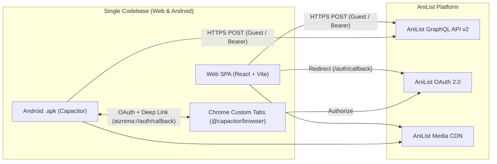

<div align="center">
  
  <h1>Aiznima</h1>
  <p><strong>Precision Calm for Anime &amp; Manga</strong> — Unofficial AniList Client for Web &amp; Android (<code>.apk</code>)</p>

  <p>
    <a href="#features">Features</a> •
    <a href="#why-aiznima">Why Aiznima</a> •
    <a href="#architecture--api-integration">Architecture</a> •
    <a href="#tech-stack">Tech Stack</a> •
    <a href="#getting-started">Getting Started</a>
  </p>
</div>

---

**Aiznima** is a calm, mobile-first unofficial AniList client for Web and Android that welcomes guests straight into seasonal discovery, 6-entity search, local airing schedules, and rich media, character, staff, and studio pages, while logged-in AniList users unlock one-tap `+1` list tracking, favorites, notifications, personalized recommendations, Taste DNA analytics, and user compatibility scoring. Built from a single zero-backend codebase (`React`, `TypeScript`, `Vite`, `Tailwind CSS`, `TanStack Query`, and `Capacitor`), it integrates directly with the **AniList GraphQL API v2** and **OAuth 2.0 Implicit Grant**—combining standard web callbacks with Chrome Custom Tabs and deep linking (`aiznima://auth/callback`) for Android APK builds alongside rate-limit-aware caching, DOMPurify sanitization, and automated Cloudflare/GitHub Actions delivery.

---

## Why Aiznima?

Aiznima was built to solve everyday friction points when browsing and tracking anime or manga on AniList across desktop and mobile:

- **No official AniList Android app & cramped mobile web UX:** Checking today's airing schedule or updating an episode from a mobile browser often feels slow and cluttered. Aiznima ships as both a responsive Web SPA and a native-wrapped Android `.apk` (via Capacitor) with a thumb-friendly bottom navigation bar, mobile bottom sheets, safe-area inset support, and Android Hardware Back button handling.
- **High friction for quick daily tracking:** Most trackers require multiple taps just to increment a single episode or chapter. Aiznima provides compact list cards with an optimistic **`+1` quick-update button** (complete with an **Undo** toast) and dedicated **My List** / **Watching** filters directly on the airing schedule.
- **Forced login walls before exploration:** Many companion apps lock their interface behind a sign-in screen. Aiznima follows a **Guest-First** design—discovery, seasonal charts, multi-entity search, schedules, detail pages, and public user lookups work out of the box with zero login required.
- **Dual-codebase & backend hosting overhead:** Maintaining separate Web and Android codebases alongside a custom backend server adds cost and complexity. Aiznima uses a **100% client-centric, zero-backend architecture** from a single codebase, serving static web assets on Cloudflare and building signed `.apk` releases via GitHub Actions.
- **Surface-level profile stats:** Standard list counts rarely reveal *why* you gravitate toward certain shows or how your taste compares with friends. Aiznima includes client-side **Taste** and **Compatibility** engines that compute your Taste DNA, Genre Matrix, studio/staff/VA loyalty, prequel-resolved recommendations, and user-to-user match scores directly on-device.

---

## Features

### Guest-Accessible (No Login Required)

- **Discover & Seasonal Browser (`/`, `/discover/seasonal`):** Hero highlight banner, Anime/Manga switcher, curated carousels (*Trending Now*, *Popular This Season*, *Upcoming Next Season*, *Top Rated*), and an infinite-scroll seasonal browser with format and sort filters.
- **6-Entity Search & Advanced Filtering (`/search`):** Debounced search across **Anime**, **Manga**, **Character**, **Staff**, **Studios**, and **Users** with format, status, season, year, genre, tag/tag-category, and birthday filters, character-name matching inside media queries, fallback search normalization, Grid/Row view toggle, and **Taste Match** sorting (when logged in).
- **Local Airing Schedule (`/schedule`):** Daily episode schedule rendered in your device's local timezone with live countdowns and behind-episode indicators.
- **Rich Detail Pages (`/media/:id`, `/character/:id`, `/staff/:id`, `/studio/:id`):**
  - **Media:** Overview (collapsible HTML synopsis, spoiler-toggleable tags, YouTube trailer & streaming/external links, Share button), Related entries, Characters with Japanese voice actors, Staff credits, and Recommendations.
  - **Character, Staff/VA, & Studio:** Biographies, paginated credits/filmographies, and media filters.
- **Public User Lookup (`/user/:username`):** Search and inspect any user's public AniList profile, favorites, and anime/manga lists with clear handling for private profiles and missing accounts.

### Authenticated & Client-Side Intelligence (AniList OAuth 2.0)

- **My List Management (`/my-list`):** Multi-chunk `MediaListCollection` loading across all standard statuses (`CURRENT`, `PLANNING`, `COMPLETED`, `PAUSED`, `DROPPED`, `REPEATING`) and custom lists, search/format/sort controls, Grid/Row view, optimistic **`+1`** updates with **Undo**, and a full entry editor (supports all AniList `ScoreFormat` scales, progress & volumes, repeat counts, start/completed dates, private toggle, notes, and entry deletion).
- **Optimistic Favourites:** Toggle favorites across Anime, Manga, Characters, Staff, and Studios with instant UI feedback and automatic rollback on failure.
- **Notifications (`/notifications`):** Live unread count badge and categorized notification feed supporting 20 AniList `NotificationType` variants (*Airing*, *Social*, and *Media* updates).
- **Recommended For You (`/discover/recommended`):** Client-side personalized recommendations driven by your list history and deep stats, featuring *All Matches*, *Hidden Gems*, and *In Planning* views plus automatic prequel entry-point resolution.
- **Taste DNA & Deep Statistics (`/profile`):** Dedicated **Deep Stats** tab computing your Taste DNA summary, Quantity-vs-Quality Genre Matrix (*Signature*, *Hidden Favorite*, *Habitual*, *High Drop*), Tag Affinity, Studio/Staff/VA Loyalty, Source Adaptation Affinity, Rewatch/Reread Value, and interactive drill-downs across eras, formats, lengths, and countries.
- **User Taste Compatibility (`/user/:username`):** Compares your active list and genres against another user's public list to generate a compatibility score (*Soulmates*, *High Match*, *Balanced*, *Different Vibes*), shared titles, average score delta, and shared top genres.
- **Settings & Account Sync (`/settings`):** Crisp Cool Minimalist aesthetic (**Paper Slate Light Mode** default + **Deep Slate Dark Mode**), `18+` (`isAdult`) filtering with an interstitial `AdultContentGate` for direct links, local query cache clearing, and live AniList preference updates (`titleLanguage`, `scoreFormat`, `displayAdultContent`, `includeAdultContentInSearch`).

---

## Architecture & API Integration

Aiznima is **100% client-centric**—there is no intermediary server or database. Every query and mutation flows directly between the client (Web SPA or Android Capacitor WebView) and AniList.



### Key Technical Highlights

- **Lightweight GraphQL Transport ([`graphqlClient.ts`](src/shared/api/graphqlClient.ts)):** Uses a small typed `fetch` wrapper (`anilistRequest`) instead of heavy client frameworks, keeping bundle size small while centralizing `Bearer` header injection and structured error handling (`RateLimitError`, `UnauthorizedError`, `NetworkError`, `AniListApiError`).
- **Dual-Target OAuth 2.0 Implicit Grant ([`oauth.ts`](src/features/auth/services/oauth.ts)):** Never bundles a `Client Secret` in the web app or `.apk`. Uses CSRF `state` validation and `returnTo` route preservation across:
  - **Web:** Standard browser redirect to `/auth/callback`.
  - **Android `.apk`:** Launches **Chrome Custom Tabs** (`@capacitor/browser`), captures `aiznima://auth/callback` via `@capacitor/app` deep link listeners, closes the browser tab, and stores tokens in native `SharedPreferences` (`@capacitor/preferences`).
- **Rate-Limit & Failure Resilience:** Respects AniList's **90 requests/minute** limit using TanStack Query caching (`staleTime` 1–60 minutes by data volatility), debounced search queries, and `429` cooldown banners that continue serving cached data. If an access token expires (`401`) mid-edit, unsaved modal drafts are preserved so users can re-authenticate without losing their input.
- **Security & Content Safety:** All HTML synopses and user bios from AniList are sanitized with **DOMPurify** before rendering, adult entries (`isAdult: true`) are gated according to user preferences, and Android builds disable cleartext traffic (`usesCleartextTraffic="false"`) and ADB backups (`allowBackup="false"`).

---

## Tech Stack

| Layer | Technology |
| :--- | :--- |
| **UI & Core** | React 19, TypeScript 7, Vite 8, React Router 7 |
| **Styling & Icons** | Tailwind CSS v4 (CSS custom-property design tokens), Lucide React |
| **State & Data** | TanStack Query v5 (server cache & optimistic updates), Zustand v5 (auth & preferences) |
| **Mobile Runtime** | Capacitor 8 (`@capacitor/core`, `android`, `app`, `browser`, `preferences`, `status-bar`) |
| **Security & Testing** | DOMPurify, Vitest 5, Testing Library, jsdom |
| **Hosting & CI/CD** | Cloudflare Workers static assets ([`wrangler.jsonc`](wrangler.jsonc)), GitHub Actions ([`build-apk.yml`](.github/workflows/build-apk.yml)) |

---

## Getting Started

### Prerequisites

- **Node.js 22+** and **pnpm** (CI uses `pnpm` 12.18.0)
- **JDK 21** and **Android SDK** (`minSdkVersion 24`, `targetSdkVersion 36`) — only needed if building the Android `.apk` locally
- An **AniList OAuth Client ID** from [AniList Developer Settings](https://anilist.co/settings/developer)

### 1. Install Dependencies

```bash
pnpm install
```

### 2. Configure Environment Variables

Copy `.env.example` to `.env.local` and fill in your AniList Client ID:

```bash
cp .env.example .env.local
```

```env
VITE_ANILIST_API_URL=https://graphql.anilist.co
VITE_ANILIST_OAUTH_URL=https://anilist.co/api/v2/oauth/authorize
VITE_ANILIST_CLIENT_ID=your_client_id_here
VITE_OAUTH_REDIRECT_URI=http://localhost:5173/auth/callback
VITE_APP_PLATFORM=web
```

> **Note on Multi-Environment OAuth:** AniList binds one redirect URI per Client ID. Use separate Client IDs for local development (`http://localhost:5173/auth/callback`), production web (`https://<your-domain>/auth/callback`), and Android APK (`aiznima://auth/callback`).

### 3. Available Scripts

```bash
pnpm dev          # Start local Vite development server
pnpm typecheck    # Run TypeScript compiler checks (tsc --noEmit)
pnpm test         # Run Vitest unit & integration test suite
pnpm build:web    # Build production web bundle into dist/
pnpm preview      # Preview production web build locally
pnpm build:apk    # Build web bundle in APK mode (vite build --mode apk)
pnpm cap:sync     # Sync dist/ into the Capacitor android/ project
```

### 4. Build & Deployment

- **Web (Cloudflare):** [`wrangler.jsonc`](wrangler.jsonc) is configured to serve `./dist` as static assets with `single-page-application` fallback routing so deep routes like `/media/1` and `/auth/callback` resolve cleanly.
- **Android `.apk` (GitHub Actions):** Pushing a `v*` tag or triggering **Build & Release Android APK** in [`.github/workflows/build-apk.yml`](.github/workflows/build-apk.yml) runs `typecheck`, `test`, `pnpm build:apk`, `npx cap sync android`, and Gradle `assembleRelease` (signing with repository keystore secrets when configured, or falling back to debug signing), then uploads the `.apk` artifact and publishes a GitHub Release on tags.

---

## Project Structure & Documentation

```text
aiznima/
├── .github/workflows/   # Automated Android APK build & GitHub Release pipeline
├── android/             # Capacitor native Android project (com.aiznima.app)
├── docs/                # Brand SVGs & technical specifications
├── public/              # Static assets & favicon
└── src/
    ├── app/             # Root providers, router, responsive AppShell, AuthGuard
    ├── features/        # Feature modules (auth, discover, search, schedule, media,
    │                    # character, staff, studio, my-list, notifications,
    │                    # profile, taste, user, settings)
    ├── platform/        # Web vs Capacitor adapters (storage, browser, back/deep-link hooks)
    └── shared/          # GraphQL client, QueryClient, types, reusable UI, stores, utils
```

Further design and technical specifications are available in `docs/`:
- [Product Requirements Document (`docs/prd.md`)](docs/prd.md)
- [Architecture Document (`docs/architecture.md`)](docs/architecture.md)
- [Design System & UX Spec (`docs/design.md`)](docs/design.md)
- [API Reference & Integration Guide (`docs/api.md`)](docs/api.md)

---

## Disclaimer

Aiznima is an **unofficial** third-party client powered by the public [AniList API](https://anilist.co). It is not affiliated with, endorsed by, or maintained by AniList. All anime, manga, character, staff, studio metadata, and artwork are provided by AniList and their respective owners.
