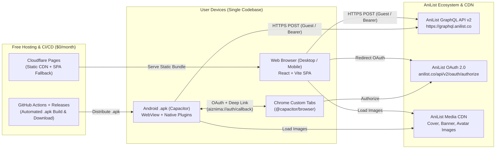
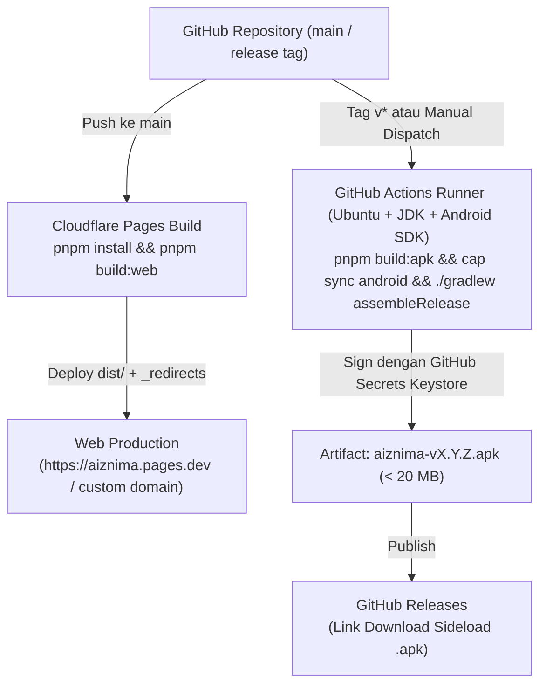

# Architecture Document — Aiznima

**Versi Dokumen:** 1.0  
**Status:** Draft Final (Siap Implementasi)  
**Dokumen Terkait:** [prd.md](./prd.md) | [design.md](./design.md)  
**App ID (Android):** `com.aiznima.app`  
**Deep Link Scheme:** `aiznima://auth/callback`  
**Package Manager:** `pnpm`  

---

## 1. Infrastructure Architecture

**Aiznima** dirancang dengan arsitektur **100% Client-Centric / Zero-Backend** agar biaya hosting dan distribusi tetap **\$0 (gratis)** serta mudah dikelola dari satu codebase untuk **Web (SPA)** dan **Android (`.apk`)**.



### Prinsip Infrastruktur
* **Tanpa Server / Database Sendiri:** Seluruh data katalog, daftar user (`MediaList`), dan profil disimpan di server AniList. Aplikasi bertindak sebagai *thin-client* cerdas dengan caching lokal di sisi perangkat.
* **Dua Target Build dari Satu Source:**
  * Build **Web** menghasilkan file statis (`dist/`) untuk di-deploy ke **Cloudflare Pages**.
  * Build **APK** mem-bundle file statis dengan konfigurasi env khusus APK ke dalam project **Capacitor Android**, lalu di-compile oleh **GitHub Actions** menjadi `.apk` siap sideload di **GitHub Releases**.

---

## 2. Folder Structure

Struktur kode menerapkan **Feature-based Architecture** yang dikombinasikan dengan **Platform Adapter Layer** (`src/platform/`) agar kode bisnis dan UI terisolasi bersih dari perbedaan API Web vs Android Capacitor.

```text
aiznima/
├── .github/
│   └── workflows/
│       └── build-apk.yml          # CI otomatis build & release .apk Android
├── android/                       # Native Android project (generated by Capacitor)
│   └── app/src/main/
│       └── AndroidManifest.xml    # Konfigurasi deep link aiznima://auth/callback
├── public/
│   ├── _redirects                 # Cloudflare Pages SPA fallback (/* /index.html 200)
│   └── icons/                     # Favicon & web icons
├── src/
│   ├── app/
│   │   ├── App.tsx                # Root providers (QueryClient, Router, ErrorBoundary)
│   │   ├── router.tsx             # Route definitions (BrowserRouter)
│   │   └── layouts/
│   │       ├── AppShell.tsx       # Responsive layout: BottomNav (<768px) / Sidebar (>=768px)
│   │       └── AuthGuard.tsx      # Pembatas rute khusus user login (arahkan prompt login)
│   ├── features/
│   │   ├── auth/
│   │   │   ├── api/               # Query Viewer & token validation
│   │   │   ├── components/        # LoginPromptModal, AuthStatusBadge
│   │   │   ├── pages/             # AuthCallbackPage (/auth/callback)
│   │   │   └── services/          # OAuth URL builder, state CSRF generator, deep link handler
│   │   ├── discover/
│   │   │   ├── api/               # Trending, Popular Season, Upcoming, Top Rated queries
│   │   │   ├── components/        # HeroBanner, MediaCarousel, SectionHeader
│   │   │   └── pages/             # HomePage (/)
│   │   ├── search/
│   │   │   ├── api/               # Search & Genre/Tag collection queries
│   │   │   ├── components/        # FilterSheet, SearchBar (debounced)
│   │   │   └── pages/             # SearchPage (/search)
│   │   ├── schedule/
│   │   │   ├── api/               # AiringSchedule queries
│   │   │   ├── components/        # DaySelector, AiringCard (countdown)
│   │   │   └── pages/             # SchedulePage (/schedule)
│   │   ├── media/
│   │   │   ├── api/               # Media detail, relations, characters, recommendations
│   │   │   ├── components/        # OverviewTab, RelationsTab, CharactersTab, RecommendationsTab, AdultContentGate
│   │   │   └── pages/             # MediaDetailPage (/media/:id)
│   │   ├── my-list/
│   │   │   ├── api/               # MediaListCollection, SaveMediaListEntry, DeleteMediaListEntry
│   │   │   ├── components/        # ListEntryCard (+1 quick action & Undo), ListEditorModal
│   │   │   └── pages/             # MyListPage (/my-list)
│   │   ├── profile/
│   │   │   ├── api/               # Viewer/User profile, stats, UpdateUser mutation
│   │   │   ├── components/        # StatsGrid, EditProfileModal, PublicUserSearch
│   │   │   └── pages/             # ProfilePage (/profile & /user/:username)
│   │   └── settings/
│   │       ├── components/        # ThemeToggle, AdultFilterToggle, AboutAttribution
│   │       └── pages/             # SettingsPage (/settings)
│   ├── platform/
│   │   ├── index.ts               # Export adapter sesuai runtime (Web vs Capacitor)
│   │   ├── storage.ts             # localStorage (Web) vs @capacitor/preferences (APK)
│   │   ├── browser.ts             # window.location / window.open vs @capacitor/browser
│   │   └── nativeHooks.ts         # Hardware Back button & Deep Link listener (@capacitor/app)
│   ├── shared/
│   │   ├── api/
│   │   │   ├── graphqlClient.ts   # Lightweight fetch wrapper + auth/401/429 interceptors
│   │   │   ├── queryClient.ts     # TanStack Query global config & error handler
│   │   │   └── types.ts           # Shared AniList GraphQL types & enums
│   │   ├── components/            # Button, Modal/BottomSheet, MediaCard, Skeleton, EmptyState, Toast, ErrorBoundary
│   │   ├── config/
│   │   │   └── env.ts             # Validated VITE_* environment variables
│   │   ├── hooks/                 # useDebounce, useMediaQuery, useIsAdultFilter
│   │   ├── stores/
│   │   │   ├── useAuthStore.ts    # Zustand: token, expiresAt, viewer summary, logout
│   │   │   └── usePrefsStore.ts   # Zustand: theme (light default / dark), guestShowAdult, mediaType
│   │   └── utils/
│   │       ├── sanitizeHtml.ts    # DOMPurify wrapper untuk bio & sinopsis
│   │       ├── formatters.ts      # Format skor, tanggal fuzzy AniList, countdown tayang
│   │       └── logger.ts          # Dev-only structured logger
│   ├── index.css                  # Tailwind CSS + CSS variables tema & safe-area utilities
│   └── main.tsx                   # Entry point React + hydration storage adapter
├── .env.example
├── .gitignore
├── capacitor.config.ts
├── index.html
├── package.json
├── tsconfig.json
└── vite.config.ts
```

---

## 3. Frontend / Backend Separation

Aiznima menggunakan pola **Frontend + External BaaS (Backend-as-a-Service)**:

| Lapisan | Tanggung Jawab | Implementasi |
| :--- | :--- | :--- |
| **Presentation Layer** | Rendering UI responsif, navigasi, form, animasi, dan sanitasi tampilan. | `src/features/*/pages`, `components`, `src/shared/components` |
| **Application & Platform Layer** | Caching, validasi env, penyimpanan token lintas platform, deep link, dan logika bisnis sisi klien. | `TanStack Query`, `Zustand`, `src/platform/*` |
| **API Transport Layer** | Pembentukan query/mutation GraphQL, penyisipan `Authorization` header, handling `401`/`429`. | `src/shared/api/graphqlClient.ts` |
| **Backend Layer (Eksternal)** | Database Anime/Manga/User, autentikasi OAuth 2.0, otorisasi kepemilikan list, dan validasi mutasi. | **AniList Platform** (`graphql.anilist.co` & `anilist.co/api/v2/oauth`) |

**Implikasi Pemisahan Ini:**
* Tidak ada endpoint backend custom yang perlu di-deploy atau dibayar.
* Semua aturan kepemilikan data (siapa yang boleh mengedit `MediaList` atau `UpdateUser`) ditegakkan langsung oleh server AniList berdasarkan OAuth Bearer Token.
* **Batasan yang diterima:** Tidak menyimpan `Client Secret` di frontend; fitur yang membutuhkan secret (seperti Authorization Code Grant) sengaja tidak dipakai dan digantikan dengan *Implicit Grant*.

---

## 4. Data Flow

### 4.1 Read Flow (Mode Guest & Authenticated)
1. Komponen UI memanggil custom hook fitur (misal `useDiscoverMedia()` atau `useMyList()`).
2. Hook memakai `useQuery` dari **TanStack Query** dengan `queryKey` terstruktur (mis. `['media', id, isAdult]`).
3. Jika data di cache masih *fresh*, UI langsung merender tanpa memanggil jaringan.
4. Jika *stale*/belum ada, `graphqlClient` mengirim `POST` ke `https://graphql.anilist.co`.
   * Jika user login, header `Authorization: Bearer <token>` otomatis disisipkan.
   * Jika Guest, request dikirim tanpa header `Authorization`.
5. Respons JSON disimpan di cache TanStack Query dan dirender ke UI; field HTML (`description`, `about`) melewati `sanitizeHtml()` sebelum dirender.

### 4.2 Write / Mutation Flow (Mode Authenticated)
1. User menekan aksi **`+1` Episode**, **Save Entry**, atau **Save Profile**.
2. Hook fitur memanggil `useMutation` -> mengirim mutasi GraphQL (`SaveMediaListEntry`, `DeleteMediaListEntry`, atau `UpdateUser`) dengan token Bearer.
3. Pada aksi cepat seperti `+1` progress, UI dapat melakukan **optimistic update** pada cache `['myList']` (dengan rollback otomatis jika request gagal).
4. Setelah mutasi sukses, TanStack Query melakukan `invalidateQueries` pada key terkait (`['myList']`, `['media', mediaId]`, atau `['viewer']`) sehingga seluruh halaman otomatis sinkron.

### 4.3 Native Platform Event Flow (Khusus `.apk`)
* **Deep Link OAuth:** OS Android menangkap `aiznima://auth/callback#access_token=...` -> memicu listener `App.addListener('appUrlOpen')` di `src/platform/nativeHooks.ts` -> parser mengekstrak `access_token`, `expires_in`, & validasi `state` -> menutup Chrome Custom Tab -> menyimpan sesi ke `@capacitor/preferences` -> memuat query `Viewer`.
* **Hardware Back:** Event `backButton` dari `@capacitor/app` mengecek apakah modal/drawer terbuka atau history router bisa mundur (`window.history.length`); hanya keluar app jika berada di root route utama.

---

## 5. API Architecture

* **Endpoint Tunggal:** `https://graphql.anilist.co`
* **Protokol:** HTTP `POST` dengan `Content-Type: application/json` dan `Accept: application/json`.
* **Transport Client:** Wrapper `fetch` ringan (`src/shared/api/graphqlClient.ts`)—tidak menggunakan Apollo Client atau urql agar ukuran bundle tetap kecil dan tidak tumpang-tindih dengan cache TanStack Query.

### Fitur Wajib di `graphqlClient.ts`
1. **Typed Request Wrapper:** Menerima string query/mutation GraphQL, objek `variables`, dan tipe generic response `<TData>` serta `<TVariables>` (dapat dikembangkan dengan GraphQL Codegen bila skema bertumbuh).
2. **Auth Header Injection:** Membaca `accessToken` terkini dari `useAuthStore.getState()` secara dinamis.
3. **Rate-Limit Awareness (90 req/menit):**
   * Membaca header rate limit bila tersedia (`X-RateLimit-Remaining`, `Retry-After`).
   * Saat menerima HTTP `429 Too Many Requests`, client melempar typed error `RateLimitError` berisi `retryAfterSeconds` agar TanStack Query melakukan jeda terkendali dan UI menampilkan notifikasi singkat.
4. **Auth Expiry Handling:** Saat menerima HTTP `401 Unauthorized` (atau error autentikasi token tidak valid), client otomatis memanggil `useAuthStore.getState().logout()` dan memicu prompt login ulang.
5. **GraphQL Partial Error Extraction:** Mengecek properti `errors[]` dari body JSON GraphQL meskipun status HTTP bernilai 200/400, lalu memetakannya ke `AniListApiError`.
6. **Query Efficiency:**
   * Hanya meminta field yang benar-benar dirender per komponen (*no overfetching*).
   * Pencarian teks wajib memakai `useDebounce` (`400ms–500ms`) sebelum memicu query ke API.

---

## 6. State Management

Pembagian state dibuat tegas berdasarkan jenis datanya agar tidak ada duplikasi sumber kebenaran:

| Kategori State | Tool | Contoh Data | Masa Hidup & Persistensi |
| :--- | :--- | :--- | :--- |
| **Server State** | **TanStack Query** | Hasil Discover, Search, Airing Schedule, Media Detail, `MediaListCollection`, `Viewer`, `User` | Di memori selama sesi (dengan `staleTime` 5–15 menit untuk detail statis, 1–2 menit untuk list/schedule). |
| **Auth & Session State** | **Zustand** (`useAuthStore`) | `accessToken`, `expiresAt`, `isHydrated`, `viewerId` | Dipersist via `platform.storage` (`@capacitor/preferences` di APK, `localStorage` di Web). |
| **App Preferences State** | **Zustand** (`usePrefsStore`) | `theme` (`'light'` default / `'dark'`), `guestShowAdult` (`boolean`), `activeMediaType` (`ANIME`/`MANGA`) | Dipersist via `platform.storage`. |
| **URL & Navigation State** | **React Router (`BrowserRouter`)** | Rute aktif, parameter `/media/:id`, `/user/:username`, query filter `/search?q=...&season=...` | Di URL history (tidak memakai `HashRouter`). |
| **Local UI State** | **React `useState`** | Input form sementara, modal open/close, tab aktif lokal | Ephemeral (hilang saat komponen unmount). |

---

## 7. Authentication

Aiznima menggunakan **OAuth 2.0 Implicit Grant** karena aplikasi berjalan tanpa backend dan AniList membatasi **1 Redirect URI per Client ID**.

### Strategi Multi Client ID
| Target Environment | `VITE_OAUTH_REDIRECT_URI` | Catatan Konfigurasi di AniList Developer Settings |
| :--- | :--- | :--- |
| **Local Development** | `http://localhost:5173/auth/callback` | Client App khusus dev lokal. |
| **Web Production** | `https://<domain-cloudflare>/auth/callback` | Client App khusus Web produksi. |
| **Android `.apk`** | `aiznima://auth/callback` | Client App khusus APK Android; didaftarkan di `AndroidManifest.xml` intent-filter. |

### Alur Teknis OAuth Implicit Grant
1. Saat user klik **Login with AniList**, aplikasi membuat string acak `state` (CSRF token) serta menyimpan `oauth_state` dan `oauth_return_to` (rute asal) sementara, lalu membentuk URL otorisasi:
   `https://anilist.co/api/v2/oauth/authorize?client_id=<CLIENT_ID>&response_type=token&state=<STATE>`
2. **Di Web:** Browser pindah halaman ke URL OAuth -> user klik Authorize -> kembali ke `/auth/callback#access_token=...&token_type=Bearer&expires_in=...&state=...` -> `AuthCallbackPage` membaca `window.location.hash`, memvalidasi kecocokan `state`, menyimpan token -> redirect kembali ke `oauth_return_to` (atau `/`).
3. **Di `.apk`:** Aplikasi membuka URL OAuth melalui `Browser.open({ url })` (**Chrome Custom Tabs**) -> user klik Authorize -> Android memicu `aiznima://auth/callback#access_token=...&state=...` -> `App` deep link listener memparsing fragment hash, memvalidasi `state`, memanggil `Browser.close()`, menyimpan token ke `@capacitor/preferences`, dan menyegarkan state auth pada rute asal.
4. **Pembatalan / Gagal Auth (`AF-01`):** Jika callback membawa error, user menutup Custom Tab, atau `state` tidak cocok, aplikasi menghapus `oauth_state`, tetap menjaga user di **Mode Guest** pada rute `oauth_return_to`, dan menampilkan toast pemulihan.
5. **Masa Berlaku Token:** Token OAuth AniList berlaku **1 tahun** tanpa *refresh token*. Aplikasi menyimpan perkiraan waktu kedaluwarsa (`expiresAt`) dan membersihkan sesi secara otomatis saat token kedaluwarsa atau menerima `401`.

---

## 8. External Services

1. **AniList GraphQL API v2** (`https://graphql.anilist.co`) — Sumber tunggal seluruh metadata Anime/Manga, jadwal tayang, pencarian, profil publik/login, daftar tontonan/bacaan, dan mutasi akun.
2. **AniList OAuth 2.0 Service** (`https://anilist.co/api/v2/oauth/authorize`) — Layanan login dan otorisasi akun pengguna.
3. **AniList Media CDN** (`https://s4.anilist.co` / URL image yang dikembalikan API) — Pengiriman gambar cover, banner, avatar, dan karakter.
4. **YouTube** (opsional via link/thumbnail eksternal dari field `Media.trailer`) — Menampilkan pratinjau atau membuka trailer anime di aplikasi/tab eksternal.
5. **Cloudflare Pages** (Free Tier) — Hosting static web SPA dengan bandwidth gratis dan CDN global.
6. **GitHub Actions & GitHub Releases** (Free Tier) — Pipeline compile Android `.apk` di cloud dan distribusi file rilis `.apk`.

---

## 9. Deployment Architecture

Arsitektur deployment memisahkan target **Web** dan **Android `.apk`** dari satu repositori Git yang sama dengan biaya **\$0**:



### Detail Penting Deployment
* **SPA Routing Fallback di Cloudflare Pages:** File `public/_redirects` berisi `/* /index.html 200` wajib tersedia agar route `BrowserRouter` seperti `/auth/callback`, `/media/1`, atau `/user/username` tidak mengembalikan HTTP 404 saat di-refresh atau diakses langsung dari redirect OAuth.
* **Pemisahan Mode Build (`web` vs `apk`):**
  * `pnpm build:web` memakai variabel environment target **Web** (Client ID Web + Redirect HTTPS).
  * `pnpm build:apk` menjalankan `vite build --mode apk` agar bundle yang masuk ke `android/` memakai **Client ID APK** dan redirect `aiznima://auth/callback`.

---

## 10. Tech Stack

| Kategori | Teknologi Pilihan | Peran & Alasan Pemilihan |
| :--- | :--- | :--- |
| **Frontend Framework** | **React + TypeScript** | Komponen modular, type-safety ketat, dan dukungan ekosistem mobile/web luas. |
| **Build Tool** | **Vite** | Dev server cepat dan output static bundle kecil untuk Web & Capacitor. |
| **Routing** | **React Router (`BrowserRouter`)** | Path-based routing agar tidak bentrok dengan URL hash `#access_token=` OAuth. |
| **Styling & Icons** | **Tailwind CSS + Lucide React** | Desain kustom penuh, utility-first responsif, dan ukuran CSS produksi sangat kecil. |
| **Server State & Cache** | **TanStack Query** | Caching otomatis, pagination, optimistic updates, dan proteksi rate limit API. |
| **Client State** | **Zustand** | Ringan (~1KB) untuk state autentikasi dan preferensi aplikasi lintas komponen. |
| **Mobile Runtime** | **Capacitor** (`core`, `android`, `browser`, `app`, `preferences`, `status-bar`) | Membungkus Web SPA menjadi `.apk` native dengan Chrome Custom Tabs, Deep Link, & Preferences storage. |
| **API Transport** | **Native `fetch` GraphQL Wrapper** | Tanpa library GraphQL berat; kendali penuh atas header, `401`, dan `429`. |
| **Security / Sanitizer** | **DOMPurify** | Sanitasi HTML sinopsis/bio dari AniList untuk mencegah XSS. |
| **Backend & Database** | **Tidak Ada (AniList API sebagai remote source)** | Menghemat biaya server menjadi \$0; persistensi lokal hanya untuk token & preferensi. |
| **Package Manager** | **`pnpm`** | Instalasi cepat dan hemat ruang disk. |
| **Hosting & CI/CD** | **Cloudflare Pages + GitHub Actions + GitHub Releases** | Deploy Web gratis (unlimited bandwidth) dan compile `.apk` otomatis di cloud. |

---

## 11. Environment & Config Management

### Variabel Environment (`VITE_*`)
Semua variabel konfigurasi sisi klien wajib memiliki prefix `VITE_` dan divalidasi saat startup oleh `src/shared/config/env.ts`:

```env
# .env.example
VITE_ANILIST_API_URL=https://graphql.anilist.co
VITE_ANILIST_OAUTH_URL=https://anilist.co/api/v2/oauth/authorize
VITE_ANILIST_CLIENT_ID=your_client_id_here
VITE_OAUTH_REDIRECT_URI=http://localhost:5173/auth/callback
VITE_APP_PLATFORM=web
```

### Manajemen Konfigurasi per Lingkungan
* **Local Dev (`.env.local`):** Tidak di-commit ke Git (masuk `.gitignore`). Menggunakan Client ID khusus `localhost`.
* **Web Production (Cloudflare Pages Dashboard):** Diisi di menu *Environment Variables* Cloudflare Pages (`VITE_APP_PLATFORM=web`, Client ID Web, Redirect HTTPS).
* **Android `.apk` (GitHub Actions Secrets & `.env.apk.production`):**
  * `VITE_ANILIST_CLIENT_ID` (untuk APK) disimpan di **GitHub Secrets** atau env build workflow.
  * `ANDROID_KEYSTORE_BASE64`, `ANDROID_KEYSTORE_PASS`, `ANDROID_KEY_ALIAS`, `ANDROID_KEY_PASS` wajib disimpan di **GitHub Secrets** agar `.apk` rilis tertandatangani konsisten untuk upgrade tanpa perlu uninstall.
* **Konfigurasi Capacitor (`capacitor.config.ts`):**
  * `appId`: `com.aiznima.app`
  * `appName`: `Aiznima`
  * `webDir`: `dist`

---

## 12. Error Handling & Logging Strategy

### Strategi Penanganan Error Berjenjang (Selaras Alternate Flows di [design.md](./design.md))
1. **Transport & API Level (`graphqlClient.ts`):**
   * **Network Error / Offline (`AF-04`):** Menangkap `TypeError` jaringan; jika data cache sudah ada di TanStack Query, tetap tampilkan cache dengan indikator offline + tombol *Retry*.
   * **HTTP `429` (Rate Limit, `AF-03`):** Mencegah *retry storm*; menunda request sesuai `Retry-After` (atau default cooldown), mempertahankan cache lama bila tersedia, dan menampilkan banner/toast *"Rate limit reached"*.
   * **HTTP `401` (Token Expired/Invalid, `AF-02`):** Membersihkan sesi di `useAuthStore` + `platform.storage` tanpa menutup modal/draft form yang sedang diedit user, lalu menampilkan prompt login ulang di tempat.
   * **GraphQL Errors & Private Lists (`AF-05`):** Mengekstrak pesan dari payload `errors[]` menjadi typed error (termasuk membedakan kasus *Private List* atau *User Not Found* dari error jaringan).
2. **Global Query / Mutation Level (`queryClient.ts`):**
   * `MutationCache.onError` otomatis memunculkan Toast error saat aksi simpan/hapus gagal (sekaligus rollback optimistic update).
   * `QueryCache.onError` menangani error latar belakang tanpa merusak halaman yang masih memiliki data cache lama.
3. **UI Component Level (`ErrorBoundary` & Content Gates):**
   * Root & route-level React **Error Boundary** menangkap error render tak terduga dan menampilkan halaman fallback dengan tombol *Reload App* (krusial di WebView Android agar app tidak berhenti di layar putih).
   * Komponen **AdultContentGate** (`AF-06`) & image fallback (`AF-07`) menjaga agar konten `18+` terfilter aman dan broken cover tidak merusak layout grid.
4. **Native Platform Level:**
   * Guard `try/catch` saat memanggil plugin Capacitor (`Browser.open`, `Preferences`) dan validasi URL deep link sebelum parsing token (`AF-01`).

### Strategi Logging
* **Tanpa SDK Telemetry Eksternal di v1:** Untuk menjaga ukuran `.apk` tetap kecil dan privasi pengguna penuh, tidak menggunakan layanan pelaporan pihak ketiga (seperti Sentry) di v1.
* **Structured Local Logger (`src/shared/utils/logger.ts`):**
  * Di mode development (`import.meta.env.DEV`): mencatat detail query gagal, durasi, dan event native (`debug`/`warn`/`error`) di console.
  * Di mode production: log debug ditekan; hanya error kritis non-sensitif (tanpa pernah mencetak `accessToken`) yang dicatat ke console agar mudah didiagnosis saat debugging Web/ADB.

---

## 13. Security Considerations

1. **Zero Secret di Client / APK:**
   * Menggunakan OAuth 2.0 *Implicit Grant* sehingga **tidak ada `Client Secret`** di kode sumber, bundle JS, maupun file `.apk` (yang mudah di-decompile).
2. **Login Android via Chrome Custom Tabs (Bukan Raw WebView):**
   * Mencegah risiko manipulasi halaman login, kompatibel penuh dengan 2FA/password manager browser pengguna, dan mematuhi praktik keamanan OAuth modern di mobile.
3. **Proteksi Penyimpanan Token:**
   * Di Android `.apk`, token disimpan di `@capacitor/preferences` (native `SharedPreferences` privat milik app), bukan `localStorage` WebView yang rentan hilang saat OS membersihkan cache.
   * File `AndroidManifest.xml` menonaktifkan backup ADB (`android:allowBackup="false"`) serta mewajibkan koneksi HTTPS (`android:usesCleartextTraffic="false"`).
4. **Mitigasi XSS pada Konten Eksternal:**
   * Seluruh teks HTML/Markdown dari AniList (`Media.description`, `User.about`) wajib disanitasi menggunakan **DOMPurify** (membuang tag `<script>`, `<iframe>` berbahaya, dan event handler inline `on*`) sebelum dirender ke DOM.
   * Tautan keluar di Web menggunakan `rel="noopener noreferrer"`; di APK dibuka lewat `@capacitor/browser`.
5. **Validasi Deep Link Input:**
   * Listener `appUrlOpen` memvalidasi skema & host (`aiznima://auth/callback`) sebelum mengekstrak `access_token` dan menolak payload yang tidak valid/kosong.
6. **Kepatuhan Terms of Use AniList:**
   * Aplikasi menyertakan disclaimer jelas sebagai klien tidak resmi (*"Unofficial client powered by AniList API"*), tidak melakukan *mass scraping*, serta menyediakan filter konten dewasa (`isAdult`).
